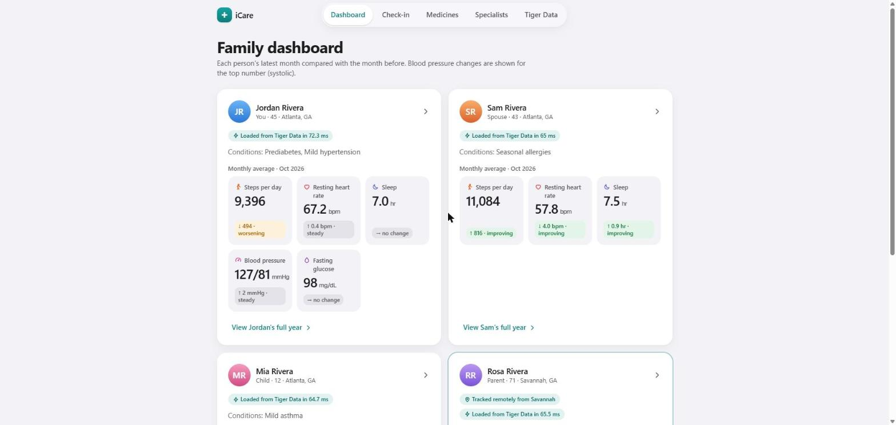
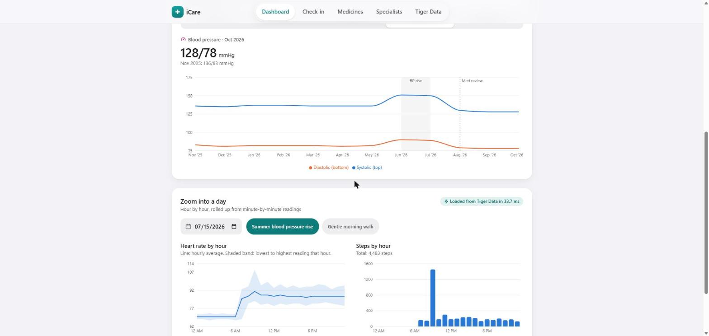
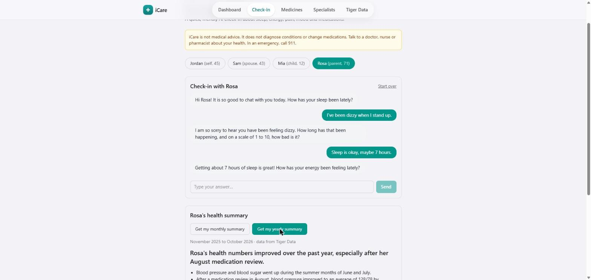
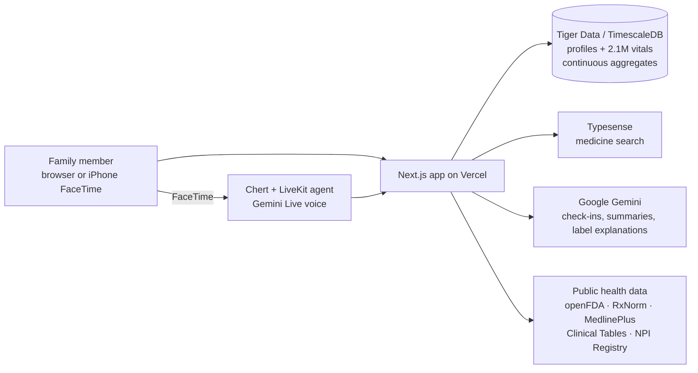
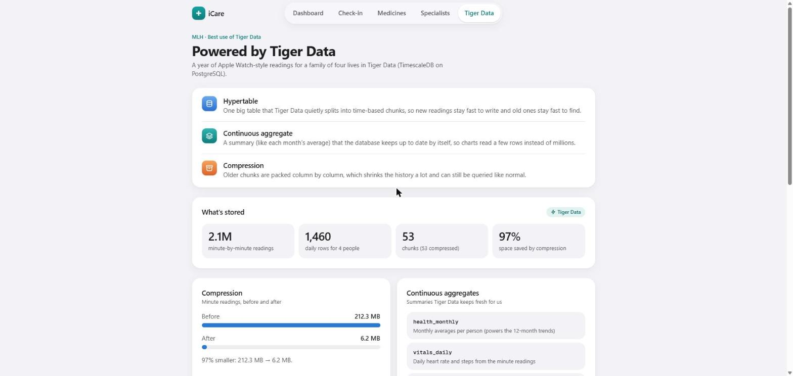

# iCare

**Your family's health, explained.** iCare gives a family one place to see a year of health data for everyone (including a grandparent who lives in another city), understand it in plain language, check in with an AI by chat or FaceTime, look up any medicine's official FDA warnings, and find the right specialist nearby.

**🌐 Live app: https://icare-wall-e9.vercel.app** · Built at **Emory Hacks 2026** (Healthcare track) · **Not medical advice.** All patient data is fictional.



## Try it in 2 minutes
Our demo follows the **Rivera family**, a fictional family with a full year of Apple Watch-style data.

1. **[Family dashboard](https://icare-wall-e9.vercel.app/dashboard):** everyone's latest month at a glance. Grandma Rosa is tracked remotely from Savannah.
2. **[Rosa's page](https://icare-wall-e9.vercel.app/family/rosa) → BP tab:** her blood pressure jumped to **151/90** this summer (missed doses) and recovered after an August medication review.
3. **[Check-in](https://icare-wall-e9.vercel.app/checkin):** pick Rosa → **Get my yearly summary** (Gemini explains her year), then **Start check-in**. Type *"I have chest pain"* to see the emergency guardrail.
4. **[Medicines](https://icare-wall-e9.vercel.app/medicines?q=wal-zyr):** search a store brand like *wal-zyr* → cetirizine. Open **[lisinopril](https://icare-wall-e9.vercel.app/medicines/lisinopril)** for the FDA boxed warning, then **✨ Explain this label simply**.
5. **[Specialists](https://icare-wall-e9.vercel.app/specialists?memberId=rosa):** real, licensed doctors near Rosa from the national NPI Registry.
6. **[Powered by Tiger Data](https://icare-wall-e9.vercel.app/data):** 2.1M readings, 97% compression, live speed test.
7. **FaceTime:** Rosa doesn't need an app. She can FaceTime iCare and the same check-in answers by voice (Chert + Gemini Live).

## What it does
| Feature | How |
|---|---|
| **Family health dashboard** with 12-month trends and an hour-by-hour day view | 2.1M minute-level readings in Tiger Data, served from continuous aggregates in a few ms |
| **AI wellness check-in** (browser chat + **FaceTime**) | Gemini asks one question at a time using the person's own data; Chert + LiveKit + Gemini Live answer real FaceTime calls |
| **Plain-language health summaries** | Gemini turns a month or a year of trends into a short report with "things to ask your doctor" |
| **Medicine search** (typos, brands, symptoms, voice) | Typesense index enriched with RxNorm brand names and FDA "uses" text |
| **Medicine pages** with FDA boxed warnings + **"Explain this label simply"** | openFDA labels + MedlinePlus; Gemini explains using only the label's own text |
| **Specialist finder** | Each condition maps to a specialty; real providers near the family member from the CMS NPI Registry |

<table>
<tr><td></td><td></td></tr>
<tr><td align="center">Rosa's summer blood pressure spike and recovery</td><td align="center">Gemini check-in and yearly summary</td></tr>
</table>

## How it works


- **Tiger Data** is our only database: relational family profiles and high-frequency metric streams side by side; hypertables in 7-day chunks; 3 continuous aggregates (hourly, daily, monthly); **212.3 MB → 6.2 MB (97%)** compression; dashboard queries in **2–5 ms** on the live site.
- **Safety first:** one shared set of AI safety rules, an emergency check (chest pain, trouble breathing, stroke signs, suicidal thoughts) that answers with 911/988 **before** any AI call, no diagnoses, no medication or dose advice, and "not medical advice" on every screen. No real patient data anywhere.
- **How we worked:** all four of us coded with **Claude Code inside identical Coder workspaces**, with every change going through a reviewed pull request and a Vercel preview.



## Run it locally
```
npm install
cp .env.example .env.local   # add keys: see docs/API-KEYS.md (public medical data needs none)
npm run dev                  # http://localhost:3000 (3001 inside Coder)
```
Without keys the app still runs: Tiger Data falls back to built-in sample data, and the public medical databases need no keys.

## What we built vs. what we used
Emory Hacks requires separating original work from frameworks.

**Built during the hackathon (after 8PM Fri Nov 13, 2026):**
- The iCare Next.js app and its API routes
- The Rivera family sample-data generator (daily and minute-level vitals) and the 38-medicine list
- Connectors for openFDA, RxNorm, MedlinePlus, NLM Clinical Tables and the NPI Registry, with condition-to-specialist matching
- Tiger Data schema (hypertables, continuous aggregates, compression), seed script and trend/cohort queries
- Typesense indexing enriched with RxNorm and FDA data
- Medicine search on Typesense (typo tolerance, facets, highlights, Rx/OTC and drug-class filters, local fallback if Typesense is down), a live search page with filter chips, voice search and "Family medicines" chips for each family member, a medicine detail page with FDA boxed warnings (repeated text removed), and a specialist finder page (per family member or any specialty near a city or ZIP)
- App shell and screens: landing page, family dashboard (latest month vs. the month before), per-person pages with 12-month trend charts and an hour-by-hour "zoom into a day" view, and a "Powered by Tiger Data" page with live storage, compression, benchmark and cohort charts
- Gemini AI layer (`src/lib/ai/`): shared safety rules, an emergency red-flag check that runs before any AI call, compact member context from Tiger Data trends, and JSON-validated Gemini calls with retry
- Gemini routes: monthly/yearly health summaries (`/api/ai/summary/<id>`), wellness check-in chat (`/api/ai/checkin`), plain-language FDA label explanations (`/api/ai/explain-label`), and the voice agent's prompt and red-flag routes
- The `/checkin` page: check-in chat, family member picker and monthly/yearly summary panel
- The Chert FaceTime check-in agent (`chert-agent/agent.mjs`): Gemini Live voice, iCare's shared prompts and safety rules, emergency check on every caller sentence

**Frameworks, libraries and services used:**
- Next.js, React, TypeScript, Tailwind CSS (scaffolded with `create-next-app`)
- Google Gemini API (`@google/genai`): `gemini-3.5-flash-lite` for text, Gemini Live native audio (`gemini-2.5-flash-native-audio-preview-12-2025`) for FaceTime voice
- Typesense Cloud (`typesense`)
- Web Speech API (built into the browser, no package): voice search on the Medicines page
- Recharts (`recharts`): charts on the dashboard, family and Tiger Data pages
- Tiger Data / TimescaleDB (`pg`): our database for health history
- Public data: openFDA (U.S. FDA), RxNorm/RxNav, MedlinePlus Connect and Clinical Tables (U.S. National Library of Medicine), NPI Registry (CMS)
- Chert FaceTime (`@trychert/facetime` CLI); `chert-agent/` started from Chert's video-agent starter (`chert-rooms.mjs`, `greet.mjs`, `face.mjs` are Chert's files)
- LiveKit Agents for Node (`@livekit/agents`, `@livekit/rtc-node`, `@livekit/agents-plugin-google`) and LiveKit Cloud
- Coder (dev environments), Vercel (hosting)

## Team
- **Cam** — Lead / Product & Pitch
- **Ish** — AI & Video (Gemini + Chert)
- **Jam** — Search & Backend (Typesense + Tiger Data)
- **TD** — Frontend & Design

## For the team: docs
| File | What's in it |
|---|---|
| [QUICKSTART.md](QUICKSTART.md) | Get connected: Coder workspace, setup script, keys, Claude Code |
| [CLAUDE.md](CLAUDE.md) | Team, rules, features and their live status, stack (Claude Code reads this automatically) |
| [docs/WORKFLOW.md](docs/WORKFLOW.md) | How we work: branches, PRs, reviews, merges, deploys, keys, file ownership, timeline |
| [docs/TEAM-PROMPTS.md](docs/TEAM-PROMPTS.md) | Copy-paste Claude Code prompts for each teammate's task, plus the PR review prompt |
| [docs/API-KEYS.md](docs/API-KEYS.md) | Which keys exist, who has them, adding them locally and in Vercel |
| [docs/SAMPLE-DATA.md](docs/SAMPLE-DATA.md) | The fictional Rivera family and the medicine list |
| [docs/MEDICAL-DATA.md](docs/MEDICAL-DATA.md) | Public medical databases, Tiger Data, and every API route |
| [docs/CHERT.md](docs/CHERT.md) | The FaceTime check-in agent |
| [docs/DEMO.md](docs/DEMO.md) | 2-minute demo script, backups and likely judge questions |
| [docs/DEVPOST.md](docs/DEVPOST.md) | Submission draft and status |
